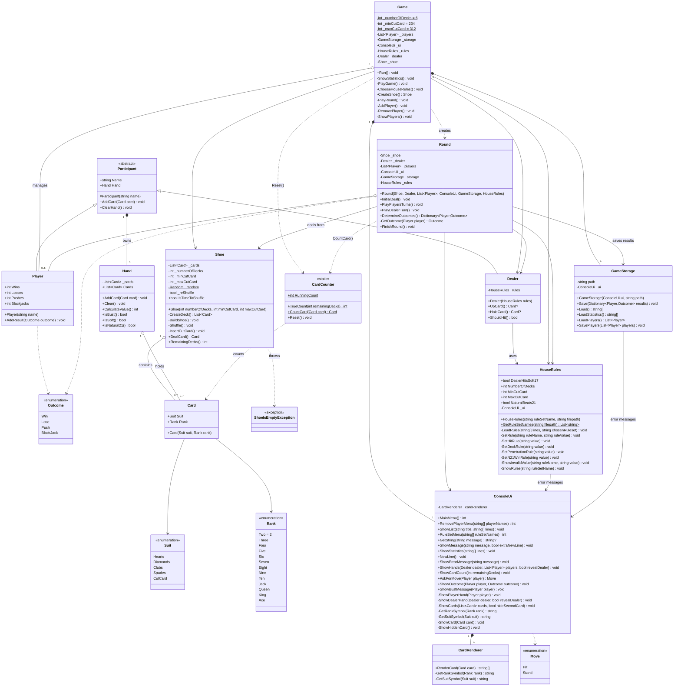

# Title: Tjugoett (Blackjack) - Kunskapskontroll 3 - Group Report
#### **Creators:**
* Tomas Törnkvist (TT), Github: tomastornkvist
* Gantiana Haliti (GH), Github: Gentianahaliti
* Arne Hagman (AH), Github: nhagman-creator & Unknown
* Ai Doan (AD), Github: Chiminii (Left the programme about half way through the assignment)
#### **Date:**          22 Oct 2026
#### **Program:**       MAI26MA
#### **Course:**        Module II - Programmering och objektorienterad utveckling i C-sharp
#### **Assignment:**    Kunskapskontroll 3 - Tjugoett (Blackjack)
#### **Description:**   Single or multiplayer computer game that follow international Blackjack rules

## Description

**Goal:**
Card game against the computer (dealer) to try to achieve the total value of 21, or to be as close to it as possible, without exceeding it.

**Starting the program from VS Code:**
1. Install .NET SDK in VS Code
2. Open a terminal in the project folder where Kunskapskontroll 3.csproj is located
3. Run the command `dotnet run`

**Starting the program with the built executable:**
1. Copy Kunskapskontroll 3.exe, Kunskapskontroll 3.dll and Kunskapskontroll 3.runtimeconfig.json from bin\Debug\net10.0 to a directory of your choice
2. Double click or otherwise activate Kunskapskontroll 3.exe
3. Have fun

If you want to play with full functionality, using different house rules, copy RuleSet.txt to the same directory.

**Program components:**\
**Menu.** Upon starting the computer program, the player will see a menu where the player(s) can choose to: (I) Lägg till spelare/add new player (II) Ta bort spelare/remove a player (III) Visa Spelarstatistik/show historical player statistics (IV) Börja spela/start a new game, and (V) Avsluta spelet/Exit game. When option (IV) is chosen, a submenu will appear on the console. Here the player(s) will be able to chose the different settings (house-rules) for the game. Two common house-rules that are used in the casino have been added as a full set of preset options to be chosen at the convenience of a player. These are options 1 and 2. After chosing a pre-set of rules, the game will start. Note: The player(s) might have to add themselves as players before starting a game.

**Game.** One game is divided in two rounds, the initial first round, and the second round. In the first round, all players will start with 2 open cards, and the dealer starts with an open, and a closed (hole) card. The player(s) will see open cards and make a decision on how to proceed. The second round starts with players turn(s). This is when active player choices are made. Each player can choose to hit (add one more open card) or stand (stop) with current cards when they are satisfied. In the end, the player(s) will eventually decide to stand, or get busted (exceed 21) on which the player(s) automatically lose the current game.

The second round ends with the dealer's turn. The dealer will reveal his hole card, and either hit or stand (by adhering to the House-rules as specified below). The dealer has to follow the house-rules strictly, and does not take any decisions outside the rules. The second round ends when the dealer either stand, or get busted.

In the final phase of the game, all outcomes (player(s) vs dealer) will be compared. In short - all outcomes (whether its a win or lose) will depend on the house-rules. These rules are summarized below as hard-coded or dynamic ones. Based on the rules, the winner(s) will be decided and the results will be printed. The player(s) can choose to play again (a new round will be initiated), or to quit and return to the main menu. When exiting a game, the most current player(s) list will be stored, and reused to initiate a new game. Any stored historical player-track record will be updated and saved.

**House-rules**\
Hardcoded:

1) Ace is worth 1 (hard hand) or 11 (soft hand). The default value is 11, but if the total sum of all cards would exceed 21, the value will be 1
2) Suit cards are worth 10 points
3) All other cards 2-10 are worth their corresponding values
4) Natural Blackjack (Ace + Suit, or 11 + 10) is the highest achievable hand
5) Closest hand to 21 always wins

Dynamic:

5) Dealer rule: i.e. always stand on soft 17, or hard 17
6) Deck size rule: i.e. A shoe (container of cards) can consist of 1 or more decks
7) Playable cards in game: i.e. A Cut-card divides the cards into a percentage of playable, and non-playable cards. Thus, its main function is to prevent the shoe from running out of cards in the middle of a game. It also acts as a means to regulate card counting. This percentage will vary depending on the strictness level
8) Win conditions: If Blackjack always wins, or i.e. draw against 21 with more than 2 cards - depends on the house-rules

**Additional features** Authors final words about the different game components. Apart from the dynamic House-rule settings already described (tillval 3 - responsible person: Arne Hagman), the game also contains improved graphics (tillval 1 - resonsible person: Gentiana Haliti), and card-counting to help a player in their decisions and multiple decks with a cut card (tillval 5 - responsible person: Tomas Törnkvist). All additional features add extra flavour to the game and enhances the user experience and game aesthetics. In other words, we hope the playability and re-playability of the game has been improved with these updates.

## Classes and how they work together

**Program** - Starts the game by creating and calling `Game`.

**Game** - Manages the overall game flow. It communicates with the players through menus in `ConsoleUi` and uses `Round` to handle each game round. `Game` creates `HouseRules`, the players, `Dealer`, `Shoe`, `GameStorage` and `ConsoleUi`, which are used during the game.

**Round** - Handles each game round, from dealing the cards until the results are compared.

**Player and Dealer** - Represent the players and the dealer. `Hand` keeps track of the cards and calculates the points, while `Card` represents an individual playing card.

**ConsoleUi** - Displays menus, cards and other information in the console. `CardRenderer` builds the graphical appearance of the cards.

**Shoe** - Manages the cards used in the game, including multiple decks and the cut card. `CardCounter` tracks the cards that have been played.

**HouseRules and GameStorage** - `HouseRules` manages the game rules, while `GameStorage` loads and saves player information, game results and statistics.

The class diagram focuses on the main classes and their relationships to show how the different parts of the program work together.

## Author contributions
The project followed the Agile/Scrum setup. Due to the fast-pace, time-limit 7 days, some steps had to be automated, or entirely skipped if deemed not necessary. I.e, the user stories and tasks were generated by AI, and authors did not specifically planned the distribution of work. Instead, we followed the model, first come-first serve when distributing the tasks among authors. The authors did try to focus on specific user stores, when choosing tasks. But for several reasons (unclear tasks, overlapping tasks with user stories, and also drop-out of an author in the process) several authors ended up working on the same user stories.  These contributions have been added by all authors, and approved by all authors, and is to the best of their knowledge correct.

**Note:** For specific information of detailed contributions, please refer to Author specific git commits/Pull requests (PR). Authors followed the process to review other authors PR. When changes were deemed necessary, reviewers requested the PR author to make the corrections - in most cases, except for some isolated cases where a reviewer made the changes themself and the PR with the dev-branch.

**Contributions to User stories**\
TT: 1, 3, 13, 14, 15, 24\
GH: 5, 6, 7, 15, 16, 17, 18, 19, 20\
AH: 8, 9, 10, 11, 12, 15, 22\
AD: 2, 4 , 8, 15

User stories:
1. As a player, I want to receive two open cards at the start of the round so that I can begin playing.  “Varje spelare får två kort, öppet.”
2. As a player, I want to choose between Hit or Stand so that I can control how my hand develops.
3. As a player, I want the game to correctly calculate soft and hard hands so that my hand value is always accurate.  “Ess… 1 eller 11 — det som är bäst för handen utan att spräcka.”
4. As a player, I want my turn to end immediately if I bust so that the round continues correctly.  “Går handen över 21 har spelaren spräckt.”
5. As a player, I want to see the dealer’s upcard so that I can make informed decisions.
6. As a player, I want natural twenty‑one to be recognized so that the round outcome follows the rules.  “Har en spelare 21 på sina två första kort… naturlig tjugoett.”
7. As a player, I want my results to be saved to a file so that they remain for the next time I play.
8. As the dealer, I want to reveal my hole card only after all players are done so that the round follows the official rules.
9. As the dealer, I want to hit while my hand value is 16 or lower so that I follow the fixed rule.
10. As the dealer, I want to stand on 17 or higher so that the game behaves consistently.
11. As a game system, I want to compare each player individually against the dealer so that the correct outcome is determined.
12. As a game system, I want to handle ties as pushes so that the round is scored correctly.
13. As a game system, I want to reshuffle the deck when fewer than 15 cards remain so that the game can continue without running out of cards.
14. As a game system, I want to validate all user input so that the program never crashes.
15. As a player, I want all console text to be in Swedish so that I understand the instructions.
16. As a player, I want the console to show my cards and their value so that I always know my situation.
17. As a player, I want the console to show the dealer’s visible card so that I can make decisions.
18. As a returning player, I want the game to load my previous results so that I can continue where I left off.
19. As a game system, I want to store player names and results in a file so that progress persists between sessions.

**Author specific special features**

20\. As a player, I want cards to be displayed as graphical boxes so that the game feels more immersive.\
22\. As a game system, I want to load rule settings from a configuration file so that the game can be customized without recompiling.\
24\. As a card counter, I want to track seen cards so that I can calculate the running and true count.

## Author notes 1: Deviations from any specifications
To our knowledge, we did not deviate from any specifications. All functionalities should be there according to the specifications in: https://mai26ma-ha.lms.nodehill.se/uploads/documents/2026-09-23T19-55-46/MAI26-kunskapskontroll-3-tjugoett.pdf

## Author notes 2: Known program shortcomings or bugs
* If the cut card is close enough to the bottom of the deck/shoe there is a risk that the cards run out during a game. This can be avoided by setting the first number of PenetrationRules high enough to have a good margin.
* If more than 1 player have the same name, their player statistics are added together. The obvious workaround is to enter different names for all players.
* Some consoles don't support the suit symbols and the card counting good times/bad times symbols.

## UML Class overview - generated by claude/rendered in mermaid

